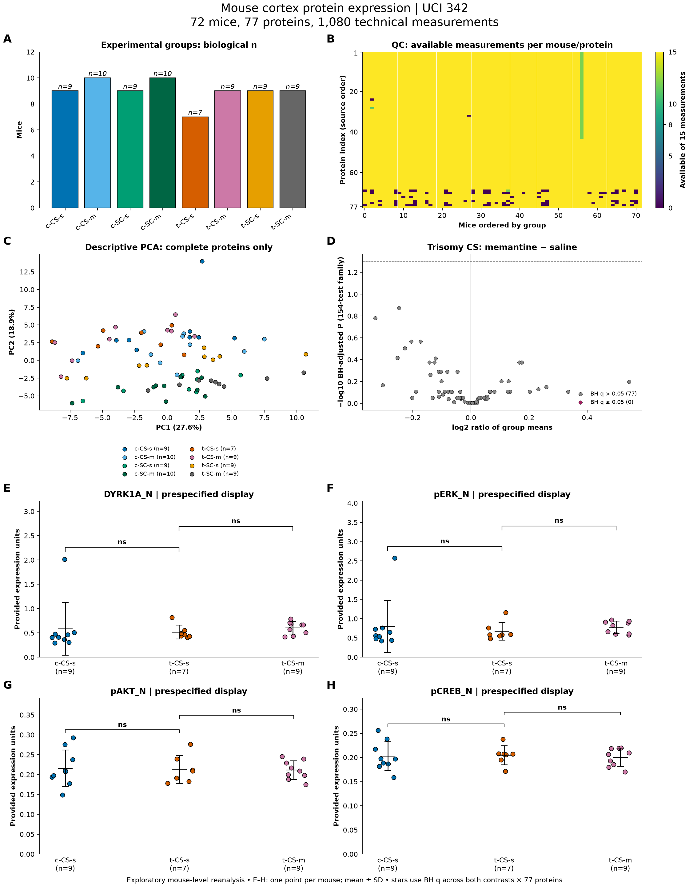

# Real biological example: mouse cortex proteins

**English** | [简体中文](EXAMPLE_BIOLOGY.zh-CN.md) · [Improvement log](IMPROVEMENTS.md) · [Analysis plan](example_biology_plan.json)

This replaces the synthetic gallery as the repository's **main worked example**. It demonstrates a complete public-data investigation, including an honest negative result after multiple-testing correction. The small `example_data.csv` / manifest / layout files and `demo_science.py` remain labeled regression fixtures so existing CLI tests stay reproducible.



[Vector PDF](example_biology.pdf) · [Editable SVG](example_biology.svg) · [All 154 results](example_biology_results.csv) · [Provenance and QC report](example_biology_report.json)

## Source and biological question

Dataset: Higuera, C., Gardiner, K., & Cios, K. (2015), **Mice Protein Expression**, UCI Machine Learning Repository, [DOI 10.24432/C50S3Z](https://doi.org/10.24432/C50S3Z), [database page](https://archive.ics.uci.edu/dataset/342/mice+protein+expression). Retrieved 2026-11-16; the page specifies [CC BY 4.0](https://creativecommons.org/licenses/by/4.0/). Credit the authors/UCI when reusing these derived figures/tables; processing changes are described below. This data license does not grant a separate software license for this repository.

The associated [primary article](https://pmc.ncbi.nlm.nih.gov/articles/PMC4482027/) describes RPPA measurements in mouse cortex nuclear fractions. Its methods identify three technical replicates of five dilutions per mouse, and discuss SOM processing and previous hierarchical analyses. Those measurements are not 15 separate animals. This case follows that biological unit despite an ambiguous independence statement on the UCI page.

The new exploratory questions, fixed in the case plan before test calculation, are:

1. Within trisomic context-shock mice, how do protein levels differ between memantine and saline (`t-CS-m` minus `t-CS-s`)?
2. Under saline/context-shock, how do trisomic mice differ from controls (`t-CS-s` minus `c-CS-s`)?

These questions do not test a genotype-by-treatment interaction or demonstrate behavioral rescue. They do not inherit the previous lab project's Vav-Cre/NAtm contrasts. “Prespecified” here means specified for this example before calculating its tests, not a registered prospective study.

## Reproduce from the public database

From a repository checkout:

```sh
python3 -m venv .venv
.venv/bin/python -m pip install '.[science]'
.venv/bin/python example_biology.py --download --directory local/mice-case
.venv/bin/figureflow inspect local/mice-case/source_values.csv
.venv/bin/python -m unittest discover -v
```

The download is explicit, HTTPS and bounded. Archive/member SHA-256 pins are in the plan and script; changed data are rejected, not silently accepted. A new output directory is required. Analysis is staged before publishing outputs. To run offline with the original downloaded ZIP:

```sh
.venv/bin/python example_biology.py --archive local/uci-mice.zip --directory local/mice-offline
```

The case-specific XLS reader uses xlrd. The generic `figureflow inspect/analyze` reader still supports CSV/TSV/XLSX, not arbitrary XLS. No API key or AI request is needed. CI uses synthetic tests only and does not download this dataset.

Outputs retain the original XLS bytes, exact parsed source values and physical row numbers, mouse/protein summaries with available-replicate counts, all comparison results, the analysis/QC report, and SVG/PDF/PNG. The report records script, plan, workbook, archive and output hashes plus library versions. It is a case report, not a generic `summary` acceptance report. Only the derived figure/results/report are published; raw workbooks remain in ignored local storage and can be downloaded from the licensed source.

## Audit findings

Computed directly from the pinned workbook:

| Check | Result |
|---|---|
| Source table | Hoja1, 1,080 data rows, 82 columns |
| Biological units | 72 unique mouse IDs; each has repeat IDs 1–15 |
| Protein columns | 77; source spelling/order retained |
| Group metadata | Genotype, treatment and behavior agree with class for every row |
| Raw missing cells | 1,396 of 83,160 protein measurements |
| Mouse/protein cells below coverage threshold | 84 of 5,544; retained as unavailable |
| Finite negative value | RRP1_N, record 365_14, −0.062007874; preserved and flagged |
| Whole-animal exclusions | None |
| Complete proteins used for PCA | 69 across all 72 mice; no imputation |

Group counts: c-CS-s 9; c-CS-m 10; c-SC-s 9; c-SC-m 10; t-CS-s 7; t-CS-m 9; t-SC-s 9; t-SC-m 9. c/t = control/trisomy; CS/SC = context-shock/shock-context; s/m = saline/memantine. Each endpoint's actual n can be smaller because of missingness; it is recorded in the result table and displayed panels.

The negative value is not assumed to be a known background-correction artifact. It is neither zeroed nor removed. Equal values are not deduplicated. An animal with unusual measurements is not silently excluded to improve significance.

## Exact analytical choices

- Primary summary: median of available supplied measurements per mouse/protein, requiring at least 8 of 15. This majority-coverage threshold is an analyst choice, not a source-paper rule or validated optimum. Missing summaries are excluded only for the affected protein; no group-mean imputation enters a test.
- Inference: two-sided Welch t on mouse summaries in the supplied expression scale. Each pair needs at least three available mice per arm and nonzero standard error. Between-mouse independence and small-sample distributional suitability remain assumptions; missing litter/batch information cannot be adjusted here.
- Effects: arithmetic mean difference A−B, Welch–Satterthwaite df and **pointwise, unadjusted** 95% CI. Volcano x is log2 of the ratio of group arithmetic means, not a log-scale test or a causal effect. Nonpositive means would leave this ratio undefined rather than inventing a pseudocount.
- Multiplicity: one fixed family of 77 proteins × 2 contrasts = 154 tests, BH adjustment. Untestable slots would retain p=1 for adjustment only and remain labeled not_testable without a reported P/q. All 154 were testable in this run. A second BY adjustment addresses arbitrary dependence more conservatively. Here q means adjusted P, not a separately estimated local FDR.
- Sensitivity: repeat the same family with mean aggregation instead of median; retain both versions. BY and aggregation sensitivities are not additional independent discoveries or replications. No threshold, exclusions or contrasts are tuned to obtain significance.
- PCA: only 69 proteins complete across all 72 mouse summaries, standardized separately to mean zero/sample SD one; NumPy SVD. No labels enter the calculation and no missing values are imputed. PCA is descriptive, not a classifier or test. PC1/PC2 explain 27.56%/18.94%; component signs may reverse across numerical implementations.

Method references: [SciPy Welch t](https://docs.scipy.org/doc/scipy/reference/generated/scipy.stats.ttest_ind.html) and [BH/BY adjustment](https://docs.scipy.org/doc/scipy/reference/generated/scipy.stats.false_discovery_control.html). BH relies on independence or suitable positive dependence; BY does not require that dependence structure. Both still require valid individual P values. Multiple-testing correction cannot repair a misspecified sampling model.

## Results: do not manufacture stars

| Contrast | Raw P < 0.05 | BH q ≤ 0.05 | BY q ≤ 0.05 |
|---|---:|---:|---:|
| Trisomy CS: memantine vs saline | 6 / 77 | 0 / 77 | 0 / 77 |
| CS saline: trisomy vs control | 13 / 77 | 0 / 77 | 0 / 77 |

The smallest BH-adjusted P is **0.133615**. NUMB_N in the drug contrast has raw P=0.00122348 but BH q=0.133615. Replacing median with mean aggregation changes zero significant/nonsignificant decisions at BH 0.05, but the numerical effects/P values do change and remain available. Lack of significance is not evidence of equality, absence of biological effect or absence of drug efficacy.

These results intentionally differ in scope/method from the published SOM study and earlier hierarchical models. We do not reproduce source class-mean imputation, outlier removal, SOM selection or three-level modeling, and do not claim a paper replication. Future dilution-aware modeling needs verified mapping of replicate/dilution/batch/litter metadata; the 1–15 suffix alone does not justify inventing that hierarchy.

## Figure interpretation and acceptance

A: actual mice per group. B: available technical measurements for every mouse/protein, with group boundaries. C: descriptive PCA of complete proteins. D: drug-contrast volcano using the entire 154-test family. E–H: DYRK1A_N, pERK_N, pAKT_N and pCREB_N were selected for display before testing; each dot is one mouse summary, bars are mean ± SD, and brackets use the full-family BH result. Full 95% effect intervals are in CSV, not the SD bars. Four displayed endpoints are not the entire tested family.

The figure uses consistent vector circles/black borders, black error bars above points, separate panel letters and 10 pt bracket text. It is a code-generated vector figure, not an edited Prism/Illustrator native file. Data QC, numeric checks and actual visual review are distinct. Both source/derived hashes and scope are recorded; a green code test alone does not certify biology.

Local verification: 103 offline tests, including eight new failure/numerical cases; all 154 Welch statistics, df, P and CI cross-checked with SciPy, and the entire BH/BY vectors independently cross-checked with SciPy. Final PNG inspected for count labels, brackets, legends, border consistency, missingness and clipping. Remote CI is reported separately for the published commit.

See the [running improvement log](IMPROVEMENTS.md) for completed fixes and remaining model/metadata work.
