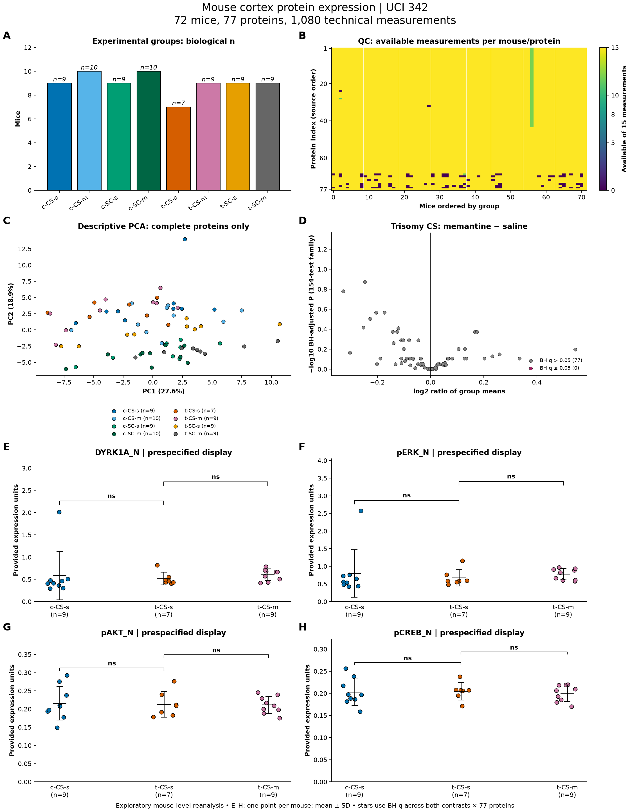

# 真实生物案例：小鼠皮层蛋白表达

[English](EXAMPLE_BIOLOGY.md) | **简体中文** · [持续完善记录](IMPROVEMENTS.zh-CN.md) · [分析计划](example_biology_plan.json)

本案例替换首页简单模拟图，成为仓库的**主要完整示例**：从公开数据库、样本审计、分析到最终图，并保留多重校正后不显著的真实结果。原 example_data.csv、格式/排版小清单及 demo_science.py 保留为明确标记的回归测试材料，避免破坏原命令测试。



[矢量 PDF](example_biology.pdf) · [可编辑 SVG](example_biology.svg) · [全部 154 项结果](example_biology_results.csv) · [来源与质控报告](example_biology_report.json)

## 数据来源与生物学问题

数据：Higuera、Gardiner、Cios（2015），UCI **Mice Protein Expression**，[DOI 10.24432/C50S3Z](https://doi.org/10.24432/C50S3Z)，[数据库页面](https://archive.ics.uci.edu/dataset/342/mice+protein+expression)。获取日期 2026-11-16；页面标明 [CC BY 4.0](https://creativecommons.org/licenses/by/4.0/)。复用衍生图表请保留作者、UCI、许可和下述处理说明。数据许可不等于另外授予本仓库软件许可证。

[原论文](https://pmc.ncbi.nlm.nih.gov/articles/PMC4482027/)描述小鼠皮层核组分 RPPA 测量，每只鼠包含 5 点稀释系列的 3 次技术重复，并讨论 SOM 和既往分层分析。这不是 15 只不同动物。UCI 页面存在将测量行描述为独立样本的含糊表述，本例依据实验方法识别生物学单位。

本例在计算检验前固定两个探索性问题：

1. 三体、context-shock 条件下，memantine 与 saline 的蛋白表达有何差异：t-CS-m 减 t-CS-s。
2. saline、context-shock 条件下，三体与对照有何差异：t-CS-s 减 c-CS-s。

不检验基因型×处理交互，也不能据此证明行为挽救；不套用旧项目 Vav-Cre/NAtm 比较。“预选”仅指本例计算前确定，不代表前瞻性注册研究。

## 从数据库复现

在完整仓库目录运行：

```sh
python3 -m venv .venv
.venv/bin/python -m pip install '.[science]'
.venv/bin/python example_biology.py --download --directory local/mice-case
.venv/bin/figureflow inspect local/mice-case/source_values.csv
.venv/bin/python -m unittest discover -v
```

下载必须明确启用，使用 HTTPS 并限制大小。计划与代码固定压缩包和原表 SHA-256；来源变化会拒绝，不静默接受。输出目录必须是新目录，计算和渲染在临时目录完成后发布。已有原始 ZIP 可离线运行：

```sh
.venv/bin/python example_biology.py --archive local/uci-mice.zip --directory local/mice-offline
```

案例专用 XLS 读取器使用 xlrd；通用 figureflow inspect/analyze 仍只支持 CSV/TSV/XLSX，不能据此宣称支持任意 XLS。本例无需 API，也不调用 AI。CI 只运行合成测试，不下载真实数据库。

本地输出包含原始 XLS 字节、解析后的源值及物理行号、每鼠每蛋白汇总及可用测量数、全部比较、质控报告和 SVG/PDF/PNG。记录脚本、计划、压缩包、原表和输出哈希及依赖版本。这是案例报告，不是可冒充完整验收的 summary 报告。仓库发布衍生图表与报告，原表保留在忽略目录，由明确许可的上游下载。

## 实际审计结果

以下由固定版本原表计算：

| 检查 | 结果 |
|---|---|
| 原始表 | Hoja1，1,080 数据行，82 列 |
| 生物学单位 | 72 个鼠 ID；每鼠重复编号恰为 1–15 |
| 蛋白列 | 77，保留原拼写和顺序 |
| 组信息 | 每行基因型、处理、刺激与 class 一致 |
| 测量缺失 | 83,160 个蛋白测量中缺失 1,396 个 |
| 汇总覆盖不足 | 5,544 个鼠—蛋白组合中 84 个不可用，保留为缺失 |
| 负值 | RRP1_N、365_14、−0.062007874，保留并标记 |
| 整鼠排除 | 无 |
| PCA 完整蛋白 | 69 个，覆盖全部 72 鼠，不插补 |

各组 n：c-CS-s 9；c-CS-m 10；c-SC-s 9；c-SC-m 10；t-CS-s 7；t-CS-m 9；t-SC-s 9；t-SC-m 9。c/t 为对照/三体；CS/SC 为 context-shock/shock-context；s/m 为 saline/memantine。单个指标的 n 可因缺失更小，在结果表和图中分别给出。

负值未被擅自解释成已知背景校正结果，未改零、未删除。相同数值不会自动去重，异常外观的动物也不会为了显著性被静默排除。

## 具体分析方法

- 主分析按每鼠每蛋白取已有值的中位数，至少需 15 次中的 8 次。多数覆盖阈值是本例分析选择，不是原论文规定或经验证的最佳值。不足仅影响该鼠该蛋白，不整鼠删除，不用组均值插补检验数据。
- 在原提供表达尺度上，对鼠汇总值做双侧 Welch t。每侧至少 3 只有效鼠且标准误非零。鼠间独立及小样本分布适用性仍是假设；缺失的同窝和批次信息不能在本例校正。
- 给出 A−B 算术均值差、Welch–Satterthwaite 自由度及未做多重校正的逐项 95% CI。火山图横轴为两组算术均值比的 log2，不是对数尺度检验或因果效应。均值非正时不伪造伪计数，比例留空。
- 固定比较家族：77 蛋白 × 2 比较，共 154 项。主分析 BH；不可检验项只在校正时占 p=1 的位置，仍标记 not_testable，不冒充有 P/q。本次全部 154 项可检验。另给更保守的 BY 敏感性结果。这里 q 指校正后 P，不是另估计的局部 FDR。
- 敏感性分析将中位数换为均值汇总，保持同一家族，保留两个版本；BY 和汇总敏感性不是独立重复验证。不为获得显著性调阈值、删鼠或增删比较。
- PCA 仅使用全部 72 鼠均可用的 69 蛋白，逐蛋白减均值、除样本标准差，再做 SVD。不用分组标签计算，不插补。PCA 只是描述，不是分类器或检验。PC1/PC2 解释 27.56%/18.94%；数值实现可整体翻转主成分符号。

方法依据：[SciPy Welch t](https://docs.scipy.org/doc/scipy/reference/generated/scipy.stats.ttest_ind.html)、[BH/BY](https://docs.scipy.org/doc/scipy/reference/generated/scipy.stats.false_discovery_control.html)。BH 依赖独立或适当正相关条件；BY 对依赖结构要求更宽。两者都需要有效的单项 P，校正不能补救错误抽样模型。

## 结果：不制造星号

| 比较 | 原始 P < 0.05 | BH q ≤ 0.05 | BY q ≤ 0.05 |
|---|---:|---:|---:|
| 三体 CS：memantine vs saline | 6 / 77 | 0 / 77 | 0 / 77 |
| CS saline：三体 vs 对照 | 13 / 77 | 0 / 77 | 0 / 77 |

最小 BH 校正 P 为 **0.133615**。药物比较中的 NUMB_N 原始 P=0.00122348，但 BH q=0.133615。均值替代中位数后，BH 0.05 的显著/不显著判定变化为 0 项；数值效应和 P 会改变，已完整保留。未显著不等于等效、没有生物学作用或没有药效。

本例方法和范围与原 SOM 论文及其讨论的分层模型不同。没有复现原文的按组插补、异常鼠排除、SOM 选择或三层模型，不宣称复现论文。后续稀释感知模型需要确认技术重复/稀释/批次/同窝映射，不能凭 1–15 后缀自行编造层级。

## 图示与验收

A 为各组实际鼠数；B 为每鼠每蛋白可用测量数，白线分隔组；C 为完整蛋白 PCA；D 为药物比较火山图，校正家族包含全部 154 项；E–H 为计算前选定展示的 DYRK1A_N、pERK_N、pAKT_N、pCREB_N。每点代表一只鼠的汇总，误差线为均值±SD，括线使用完整家族 BH 结果。效应的 95% CI 在 CSV，不能将 SD 误认为 CI。四张展示图不是全部检验范围。

统一矢量圆点、黑色边框、点上层黑误差线、独立角标及 10 pt 标注。该图由代码生成，不冒充原生 Prism/Illustrator 编辑。数据质控、数值核验与实际看图分别进行，绿色代码测试不能认证生物学正确性。

本机验证：103 项离线测试，新增 8 项失败/数值用例；154 项 Welch t、df、P、CI 均与 SciPy 交叉核对，BH/BY 完整向量也核对；最终 PNG 已检查 n、括线、图例、边框、缺失展示及裁切。发布提交的远程 CI 单独报告。

已修复和未完成事项持续写入[完善记录](IMPROVEMENTS.zh-CN.md)。
