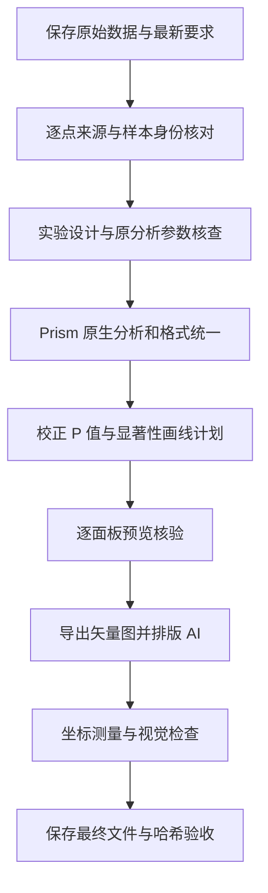

# Prism → Illustrator Figure Workflow

[](https://github.com/erickwang-17/prism-illustrator-workflow/actions/workflows/ci.yml)

**v0.2.0** · Python 3.10+ · 标准库运行时 · 原生图形独立验收

[流程](WORKFLOW.md) · [规则](RULES.md) · [任务模板](TASK_TEMPLATE.md) · [Agent 入口](SKILL.md) · [12 个设计参考](REFERENCES.md) · [更新记录](CHANGELOG.md)

可执行核验工具 + 81 项工作流清单。用来把“数据与分析正确”和“图像格式正确”分别验收，减少只改一张图、误删数据、旧星号遗留和排版反复偏移。

**当前版本不是一键统计/作图机器人。** Python 负责可复现的检查和计划；实验设计判断、Prism 原生设置、Illustrator 图形识别与最终视觉核验由操作者/agent 按工作流完成。没有直接改写 `.prism` 二进制结构，也不在后台控制应用。

仓库只含工作流、代码及明确标记的模拟示例，没有实验原始文件或聊天记录。

## 快速开始

Python 3.10 或更新版本；无需第三方 Python 包。在仓库根目录运行：

```sh
python3 -m unittest discover -v
python3 figureflow.py lint example_manifest.json --format text
python3 figureflow.py audit example_data.csv example_data.csv
python3 figureflow.py plan example_comparisons.json
python3 figureflow.py layout example_layout.json
python3 figureflow.py verify checklist.json --root .
```

最后一个命令**应该失败**：81 项初始状态均为 `unresolved`，不能自动宣称已验收。前面的检查命令使用模拟输入。检查通过退出码 0，发现差异/未完成退出码 1，输入格式或文件错误退出码 2。

可选：在虚拟环境安装命令入口。安装可能下载 setuptools 构建工具，运行时不需要第三方包。未安装仍可直接运行 figureflow.py。

```sh
python3 -m venv .venv
.venv/bin/python -m pip install .
.venv/bin/figureflow --version
.venv/bin/figureflow rules
.venv/bin/figureflow lint example_manifest.json --format text
```

已使用 uv 时也可执行 `uv run figureflow rules`。完整仓库提供 SKILL.md 的配套资源，仅复制入口文件不够。可选 pre-commit 配置与 CI 共用 unittest discover；需要自行安装 pre-commit 并在此仓库启用，没有修改全局 hooks。

所有子命令可加 `--out new-report.json`。输出文件必须尚不存在，防止覆盖原始输入或既有报告。不要用 shell 重定向覆盖输入文件。

## 从数据到最终图



完整要求见 [WORKFLOW.md](WORKFLOW.md)，可填写状态见 [checklist.json](checklist.json)，样式基准见 [style-profile.json](style-profile.json)。样式中的 `null` 表示必须从真实参考文件测量，不能用近似颜色或猜测线宽补齐。

| 工具 | 已实现 | 不能据此宣称 |
|---|---|---|
| `audit` | CSV 逐点/元数据比较，精确数值比较，排除项核对，观察值/样本计数，源和目标哈希 | 已验证实验真实性、CSV 提取正确或生物学独立性 |
| `plan` | 从已提供的校正 P 值生成连续目标组画线计划，取最少星号，保留每对结果 | 已计算 P 值、已选对统计模型、已在 Prism 画完线 |
| `layout` | 核对输入的轴线/角标共线、网格与图例横纵间距 | 已识别 AI 中真实坐标轴、已检查图像无裁切 |
| `verify` | 检查指定验收项有审阅说明、时间与文件哈希，拒绝过期证据 | 审阅判断必然正确、未列入范围的文件也已通过 |
| `prism-export` | 按显式页映射生成 PZC 导出脚本，不含 Open/Save，不覆盖已有 PDF | 已执行 Prism、页映射自动正确 |
| `hash` | 计算单文件 SHA-256 | 哈希相同就能证明科研结论正确 |
| `lint` / `rules` | 10 条带编号格式检查、严格字段/正则校验与问题位置 | 已自动提取原生样式或修复原图 |
| `summary` | 汇总指定检查报告状态、范围及文件哈希 | 所有任务都覆盖、输入仍新鲜或已经重新分析 |

## 数据输入协议

`audit source.csv candidate.csv [--exclusions exclusions.json]`

CSV 必须包含这些唯一列名：

| 列 | 含义 |
|---|---|
| `panel` | 面板/指标标识 |
| `condition` | 条件/时间点；基线也需明确写出 |
| `group` | 实际分析组，不用颜色代替 |
| `observation_id` | 能回到原始记录的稳定标识；不可在重排后重新编号 |
| `sample_id` | 生物样本身份；相同动物随访保留同一 ID |
| `value` | 精确数值或空字符串；空白不是零 |
| `unit` | 明确单位 |

可附加 `source_table`、`source_row`、`event` 等列；附加列也逐项比较。两个表的列集合须一致。身份键为 `panel + condition + group + observation_id`，允许重新排列 CSV 行。值使用 Decimal 精确比较，`1.0` 与 `1.00` 等价，不用近似容差掩盖数据差异；样本/单位等元数据必须一致。

输出 `n_observations` 和 `n_unique_samples`，它们不自动等于最终统计 n。技术重复、配对和嵌套结构须另行判断。同值的不同观察 ID 不会自动去重。

排除项必须是 JSON 数组，例如：

```json
[
  {
    "panel": "DEMO",
    "condition": "synthetic",
    "group": "Treatment",
    "observation_id": "demo-004",
    "expected_value": "1.25",
    "reason": "单独的模拟敏感性版本",
    "authorization": "明确记录用户要求或预先排除规则"
  }
]
```

这个文件只用于核查明确排除后的候选表；命令不会删除或生成数据。软件不会确认 authorization 的真实性，操作者需要保留依据。

## 显著性计划协议

参见 [example_comparisons.json](example_comparisons.json)。该文件的 P 值是模拟输入，未从真实实验计算。

每对比较必须有 `panel, condition, reference, target, p_adjusted, test, correction, family`，以及完整的 `group_order`。P 值优先用字符串保留导出精度。只有同一面板、条件、参照组、检验、校正和 family 内，且实际绘图位置连续的显著目标组才合并。不跨越未提供比较或不显著组。同 family 的反向重复组对会拒绝。

阈值为 ≤0.05 / ≤0.01 / ≤0.001 / ≤0.0001。合并等级取最大校正 P 对应的星号。输出只是画线计划；必须检查这些括线能清楚表达“参照组分别对每个目标组”，而非目标组彼此比较。

## 排版输入协议

参见 [example_layout.json](example_layout.json)。全部坐标是**相对画板左上角**的 pt，向右/向下为正。操作者必须先正确识别真实轴线/图片边缘；不能从带白边的整个 PDF 包围框取值。

- `row` 相同：`baseline_pt`、非空 `label_top_pt` 分别共线。
- `column` 相同：`x_origin_pt` 共线；确实不适用可明确为 null。
- `label_top_pt: null` 表示该面板无角标，不参与角标共线检查。
- `grid_required: true`：轴原点与基线须落在 `grid_pt` 整数倍上；false 只豁免网格，不豁免同行共线。
- `legend_gap_pt` 对 `expected_legend_gap_pt`：x 轴右端到图例块左边的水平距离。
- `legend_bottom_gap_pt` 对 `expected_legend_bottom_gap_pt`：基线到图例底边的向上距离。最终目标位置需实际测量，不再重复历史下移量。

行间可见留白、字体、点形状、误差线图层、裁切、矢量/位图内容仍需视觉检查，不能仅凭 layout 命令判定完稿。

## 最终证据

复制 checklist 到本地工作目录，为实际检查项填写 `status`、`reviewer`、`reason`、带时区的 `checked_at`，以及 `artifacts`：

```json
{
  "path": "outputs/final.ai",
  "sha256": "用 python3 figureflow.py hash outputs/final.ai 获取"
}
```

每项可关联多个文件：源数据、参数、结果、最后保存的 Prism/AI、预览、审阅说明。路径相对于 `--root`，不允许越出工作目录。`not_applicable` 也要有说明及其文件证据。版本改变后重新检查并更新证据，不机械地只更新哈希。

`verify` 只验证 `required_checks` 中的范围；该列表本身应在任务开始时审阅并保存。没有输入文件/参数/最终图对应关系的报告不足以证明数据到图的完整链条。

## 原生软件操作

1. 用 Prism 打开正确工作副本，核对当前表/图和实验设计，完成原生分析、点边框、误差线层级和格式刷。
2. 读取实际图/布局页顺序，修改 `example_export.json` 为本地面板映射。
3. 新建空导出目录，然后生成脚本：

```sh
mkdir -p local/exports
python3 figureflow.py prism-export example_export.json --directory local/exports --out local/export.pzc
```

4. 阅读生成文件，核实活动项目与页映射后在 Prism 执行。检查 `COMPLETE! No Errors.`、输出文件及每张图的实际外观。这里的命令格式源于已验证的 Prism 10 本机流程，仓库 CI 不验证专有软件宿主。
5. Illustrator 内将每图及字母分别命名，按真实轴线/图片边缘计算绝对目标位置。备份后移动，保持等比例；只移动图例时不得误动数据、轴或刻度。
6. 导出最终预览、记录相对画板的测量值，运行 layout；完成视觉核验并保存 evidence。不要把历史“一次性平移脚本”作为可重复任务。

## 测试与 CI

测试覆盖缺失值、元数据变化、同值样本、明确排除、非法 P、比较合并边界、网格豁免、横纵图例间距、过期证据和脚本注入防护。GitHub Actions 只运行合成数据与代码测试，不打开 Prism/Illustrator，也不上传科研数据。

CI 的 Action 用法参考官方 [checkout](https://github.com/actions/checkout) 和 [setup-python](https://github.com/actions/setup-python)。本机测试通过与 GitHub 远程 CI 成功是两种不同状态，发布时分别报告。

## 本地资料与发布

将实验文件放在 `local/` 或 `data/` 等被忽略的目录。`.gitignore` 是防误提交措施，不是完整的泄露检测；上传前仍需逐文件审阅。勿提交账号密码、令牌、电子邮箱、私有聊天、本机绝对路径或未经授权的原始数据。

修改核心核验逻辑时补充对应失败案例测试。修改格式规则时同步工作流/配置，并对全部相关面板重新验收。通过代码测试不等于保证所有科研判断和图像都零错误。
