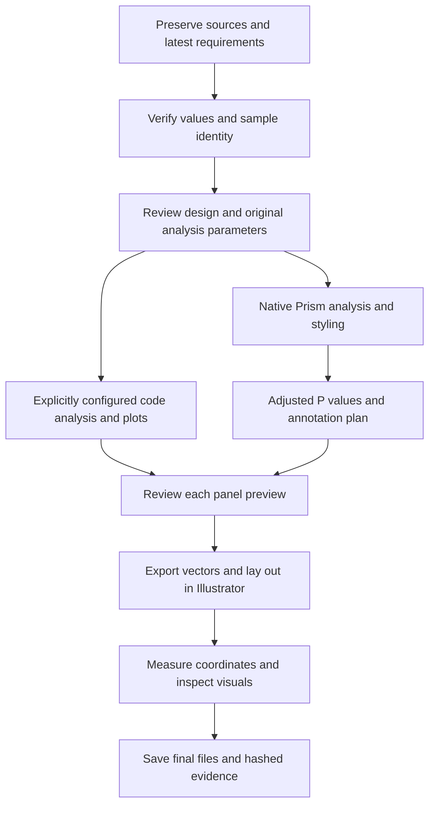
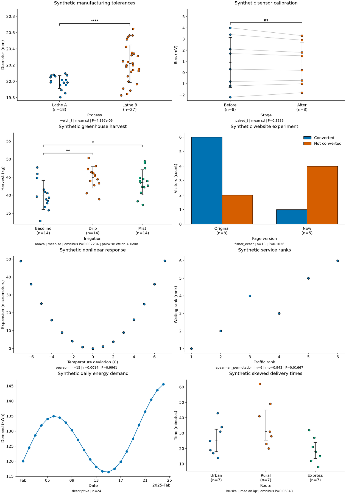

# Prism → Illustrator Figure Workflow

**English** | [简体中文](README.zh-CN.md)

[](https://github.com/erickwang-17/prism-illustrator-workflow/actions/workflows/ci.yml)

**v0.4.1** · Python 3.10+ · Standard-library audits + optional scientific computing · Separate native-figure acceptance

[API setup and troubleshooting](AI_API.md) · [General analysis and plotting](SCIENCE.md) · [Workflow](WORKFLOW.md) · [Rules](RULES.md) · [Task template](TASK_TEMPLATE.md) · [Agent entry point](SKILL.md) · [12 design references](REFERENCES.md) · [Changelog](CHANGELOG.md)

Executable verification tools and an 81-item workflow distinguish data/analysis acceptance from visual acceptance. They help prevent missed panels, accidental data deletion, obsolete significance annotations and repeated layout shifts.

`inspect/analyze` read CSV, TSV and XLSX using explicit column mappings and experimental designs, then export results, provenance and SVG/PDF/PNG figures. Supported designs include independent groups, two-condition pairs, correlation, 2×2 contingency tables and descriptive time series. See the [support matrix and limitations](SCIENCE.md). Experimental-design decisions, native Prism/Illustrator editing and final visual review remain separate responsibilities. Arbitrary data cannot be guaranteed error-free results.

The repository contains workflow materials, code and explicitly synthetic examples, without raw experimental projects or chat transcripts. English and Chinese documents share one implementation, command syntax, schemas and rule IDs. Checklist translations have identical IDs and initial states; choose one language for each task's evidence record. CLI messages and machine-readable keys remain English; documentation language does not constrain user data or questions.

## Optional API: recommended initial setup

For difficult analysis or plotting problems, the optional API can suggest diagnoses, missing information and verification steps. After installation, run `figureflow ai-setup --model YOUR_MODEL_ID`, set the key in a local environment variable, then run `figureflow ai-doctor`. See the [API guide](AI_API.md). Never submit a real key in chat or Git.

`ai-prepare` / `ai-ask` provide a review-before-send workflow; `analyze --ai-help` sends one fixed problem category only after failure. Responses and Chat Completions text protocols support configurable endpoints and models. Advice is never executed automatically and cannot change data, replace a test or turn a failure into acceptance. All existing offline functionality remains available without API setup.

## Quick start

Use Python 3.10 or later. Install the scientific extra for the complete tests and cross-domain examples:

```sh
python3 -m venv .venv
.venv/bin/python -m pip install '.[science]'
.venv/bin/python -m unittest discover -v
.venv/bin/python demo_science.py --directory local/demo
.venv/bin/figureflow inspect local/demo/manufacturing.csv
.venv/bin/figureflow analyze local/demo/manufacturing.json --output-dir local/review-run
```

The original audit commands require only the standard library:

```sh
python3 figureflow.py lint example_manifest.json --format text
python3 figureflow.py audit example_data.csv example_data.csv
python3 figureflow.py plan example_comparisons.json
python3 figureflow.py layout example_layout.json
python3 figureflow.py verify checklist.json --root .
```

The final command **should fail**: all 81 initial checks are `unresolved`. The earlier commands use synthetic inputs. Exit codes: 0 = passed within the stated scope; 1 = differences or incomplete checks; 2 = input/file errors.

For only the audit tools, install without the extra. Installation may download setuptools; the base runtime needs no third-party packages. Direct invocation of figureflow.py also works without installation.

```sh
python3 -m venv .venv
.venv/bin/python -m pip install .
.venv/bin/figureflow --version
.venv/bin/figureflow rules
.venv/bin/figureflow lint example_manifest.json --format text
```

If uv is already available, `uv run figureflow rules` also works. Keep SKILL.md with its supporting repository files. The optional pre-commit hook runs the same unittest discovery as CI; install and enable pre-commit locally if desired. No global hooks are changed.

All subcommands accept `--out new-report.json`. The destination must not exist, to protect inputs and previous reports. Do not use shell redirection to overwrite inputs.

## From data to the final figure



Read [WORKFLOW.md](WORKFLOW.md), complete [checklist.json](checklist.json), and consult [style-profile.json](style-profile.json) only for historical project conventions. New studies should use `lint --profile generic` or a custom profile, without inheriting historical groups, colors, rows or grid offsets. A `null` reference measurement must be obtained from the real reference; do not guess colors or line widths.

| Tool | Implemented behavior | Does not establish |
|---|---|---|
| `ai-setup` / `ai-doctor` | Key-free configuration and local checks | Live API connectivity, permissions or credit |
| `ai-prepare` / `ai-ask` | Preview, one explicit request, advice and usage | A solved problem, executed advice or scientific acceptance |
| `inspect` | Structure, missingness and numeric-column inspection | Experimental design or test selection |
| `analyze` | Explicit supported tests, n, available effects/CI, adjusted P, vectors and hashes | Universal support, valid assumptions or native Prism/AI edits |
| `audit` | Exact CSV value/metadata comparison, authorized exclusions, observation/sample counts and hashes | Experimental truth, correct CSV extraction or biological independence |
| `plan` | Contiguous-target annotation plans from supplied adjusted P, weakest stars and individual results | P calculation, model validity or completed Prism brackets |
| `layout` | Supplied axes/letter alignment, grid and horizontal/vertical legend gaps | Correct extraction of real AI axes or absence of clipping |
| `verify` | Reviews, timestamps and hashes for requested checks; stale-evidence rejection | Correct reviewer judgments or coverage of unlisted files |
| `prism-export` | Explicit page-mapped PZC script; no Open/Save or existing PDF overwrite | Executed Prism export or automatically correct page mapping |
| `hash` | Single-file SHA-256 | Scientific correctness |
| `lint` / `rules` | Ten numbered format rules, strict fields/regex and diagnostic locations | Native style extraction or automatic figure repair |
| `summary` | Status, scope and hashes of supplied reports | Complete scope, fresh inputs or reanalysis |

## Data input contract

`audit source.csv candidate.csv [--exclusions exclusions.json]`

Required unique CSV headers:

| Column | Meaning |
|---|---|
| `panel` | Panel/endpoint identifier |
| `condition` | Condition/time point; explicitly identify baseline |
| `group` | Actual analytical group, not a color |
| `observation_id` | Stable source-record identity; do not renumber after sorting |
| `sample_id` | Biological identity; retain the same ID for longitudinal observations |
| `value` | Exact number or empty string; blank is not zero |
| `unit` | Explicit unit |

Additional columns such as `source_table`, `source_row` or `event` are also compared. Both files must have identical column sets. The identity key is `panel + condition + group + observation_id`; row reordering is allowed. Decimal comparison treats `1.0` and `1.00` as equal without using approximate tolerances to conceal differences. Sample IDs, units and other metadata must agree.

`n_observations` and `n_unique_samples` do not automatically equal statistical n. Review technical replication, pairing and nesting separately. Equal values with distinct observation IDs are retained.

Explicit exclusions use a JSON array:

```json
[
  {
    "panel": "DEMO",
    "condition": "synthetic",
    "group": "Treatment",
    "observation_id": "demo-004",
    "expected_value": "1.25",
    "reason": "Separate synthetic sensitivity version",
    "authorization": "Recorded user instruction or prespecified exclusion rule"
  }
]
```

This verifies a candidate with declared exclusions; it does not delete or generate data. Operators must retain evidence supporting the authorization field.

## Significance-plan contract

[example_comparisons.json](example_comparisons.json) contains synthetic P values, not experimental results.

Each pair requires `panel, condition, reference, target, p_adjusted, test, correction, family` and a complete `group_order`. Prefer strings for exported P precision. Merge significant target groups only when their plotted positions are contiguous and panel, condition, reference, test, correction and family agree. Never cross an unreported or nonsignificant comparison. Reversed duplicate pairs in the same family are rejected.

Thresholds are ≤0.05 / ≤0.01 / ≤0.001 / ≤0.0001. Merged brackets use the star count corresponding to the largest adjusted P. The plan must still be reviewed to ensure brackets communicate separate reference-to-target comparisons rather than comparisons among targets.

## Layout input contract

See [example_layout.json](example_layout.json). Coordinates are points **relative to the artboard's upper-left corner**, increasing rightward/downward. Identify actual axes/image edges first; a complete PDF bounding box with white margins is insufficient.

- Same `row`: align `baseline_pt` and, separately, non-null `label_top_pt`.
- Same `column`: align `x_origin_pt`; explicitly use null only when inapplicable.
- `label_top_pt: null` excludes a panel without a letter from letter alignment.
- `grid_required: true`: origin and baseline must be multiples of `grid_pt`. False exempts the grid, not row alignment.
- `legend_gap_pt` vs `expected_legend_gap_pt`: horizontal distance from the x-axis right endpoint to the legend's left edge.
- `legend_bottom_gap_pt` vs `expected_legend_bottom_gap_pt`: upward distance from baseline to legend bottom. Measure final targets; do not repeat historical relative shifts.

Visible row spacing, fonts, point shapes, error-bar layering, cropping and vector/raster content require visual review beyond `layout`.

## Final evidence

Copy the chosen language's checklist into a local task directory. Fill `status`, `reviewer`, `reason`, timezone-aware `checked_at` and `artifacts`:

```json
{
  "path": "outputs/final.ai",
  "sha256": "Obtain with python3 figureflow.py hash outputs/final.ai"
}
```

Each check may reference sources, parameters, results, the last saved Prism/AI files, previews and review notes. Paths are relative to `--root` and cannot escape it. `not_applicable` also needs a reason and file evidence. When an artifact changes, repeat affected checks rather than mechanically replacing hashes.

`verify` checks only `required_checks`; review and save that scope at task start. A report without source/parameter/final-figure correspondence cannot establish end-to-end provenance.

## Native application operations

1. Open the correct Prism working copy; verify current tables/graphs and design. Complete native analysis, borders, error-bar layering and format-painter styling.
2. Inspect actual graph/layout page ordering; adapt `example_export.json` to local panel mappings.
3. Create a fresh export directory and generate the script:

```sh
mkdir -p local/exports
python3 figureflow.py prism-export example_export.json --directory local/exports --out local/export.pzc
```

4. Review the script, active project and mapping before running it in Prism. Check `COMPLETE! No Errors.`, output files and each rendered panel. This syntax comes from a verified local Prism 10 workflow; CI does not verify proprietary hosts.
5. Name panel objects and letters separately in Illustrator. Back up before moving, calculate absolute targets from actual axes/edges and preserve aspect ratios. Legend-only edits must not move data, axes or ticks.
6. Export previews, record artboard-relative measurements and run `layout`. Save visual-review evidence. Historical one-time translation scripts are not repeatable tasks.

## Tests and CI

Tests cover missing values, metadata changes, equal-valued observations, exclusions, invalid P, merging boundaries, grid exceptions, two-dimensional legend gaps, stale evidence and script injection. Eight synthetic cross-domain cases add numerical/rendering checks; see [SCIENCE.md](SCIENCE.md). Actions runs only synthetic data and code tests, without Prism/Illustrator or research uploads.

CI uses official [checkout](https://github.com/actions/checkout) and [setup-python](https://github.com/actions/setup-python). Report local test results and remote CI separately.

## Local files and publishing

Keep experiments under ignored `local/` or `data/`. `.gitignore` is not comprehensive leak detection: review every published file. Exclude credentials, tokens, private account information, chat logs, local absolute paths and unauthorized raw data.

Changes to verification logic need relevant failure cases. Update corresponding workflow/configuration when a format rule changes and recheck every affected panel. Code tests cannot guarantee all scientific decisions and figures are error-free.

## Synthetic cross-domain previews

These are generated test data, not research findings. The U-shaped example demonstrates that Pearson alone does not describe every relationship; the time series is descriptive only.


